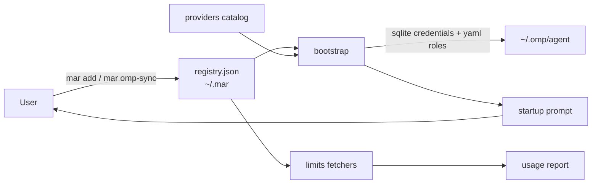

# PLAN.md — MAR (My AI Router)

Source problem: `problem_statement.txt` (verbatim user statement; treat as the
product's constitution).

## Problem

Ten AI subscriptions across ten providers, each with its own keys, models, and
scattered/hidden limits. Every fresh omp (Oh My Pi) install means key hunting,
limit-checking on websites, and per-provider manual setup. The user wants none
of that manual work.

## Product shape

A local CLI (`mar`) + data files. **Not a proxy** — MAR never carries model
traffic. It is a setup assistant and key tracker:

- registry of subscriptions (provider, key, models, default, status)
- one command to see what's active and where each limit lives
- real limit fetches where a provider exposes an API; honest manual-check
  pointers where it doesn't
- one command (`mar omp-sync`) to write everything into an omp install
- one generated startup prompt (`mar prompt`) that bootstraps a fresh omp with
  all providers, default models, and a custom follow-up prompt

## Data flow

## Milestones

| M | Slice | Acceptance criteria (all test-first) | Status |
| --- | --- | --- | --- |
| M0 | Scaffold: repo, docs, conventions, toolchain | `uv sync` works; `pytest` collects; docs complete; pushed to GitHub | done |
| M1 | `registry.py` | CRUD + versioned JSON persistence; atomic save; duplicate/missing errors; empty-file bootstrap; masked display helper | — |
| M2 | `providers.py` | Catalog of exactly the 10 providers from the problem statement; integrity validation (unique ids, https URLs, omp id shape); `get()` raises on unknown | — |
| M3 | `omp.py` | Writes `auth_credentials` rows into an agent.db matching omp's live schema (DDL in docs/architecture.md); replaces stale key rows; sets `modelRoles` in config.yml without losing other keys; missing-db bootstrap for fresh installs | — |
| M4 | `limits.py` | Real OpenRouter fetcher (`GET /api/v1/credits`, mocked HTTP in tests); `manual_hint()` returns the catalog's limits URL for the rest; `supported()` truthful | — |
| M5 | `bootstrap.py` | `render_prompt()` emits the startup prompt: all active providers, default models, `mar omp-sync` instructions, custom `~/.mar/prompt.md` section; NEVER contains key material. `sync()` drives omp adapter over the registry and reports written/skipped | — |
| M6 | `cli.py` | Subcommands `add/remove/list/limits/omp-sync/prompt`; exit codes 0/1/2; keys always masked in output; `--json` for `list` | — |
| M7 | OAuth add-flows per provider | Each provider that supports OAuth gets an interactive add flow; research-gated per provider | planned |
| M8 | Per-provider limit fetchers | Real endpoints researched and implemented one provider at a time (Codex usage, Anthropic admin usage, GitHub Copilot entitlements, …) | planned |
| M9 | `mar doctor` | Catalog verification report: which omp provider ids are confirmed, which URLs resolve | planned |

## Slice ownership (for parallel agent work)

- Wave A (independent): M1 registry, M2 providers, M3 omp — file-disjoint.
- Wave B (needs A): M4 limits (uses registry + providers), M5 bootstrap (uses
  registry + providers + omp).
- Wave C: M6 cli (uses everything), full-suite verification, integration
  commits.

## Conventions

- See AGENTS.md for the TDD loop and hard rules.
- Registry file: `~/.mar/registry.json`, versioned (`"version": 1`), atomic
  writes, 0600 best-effort (Windows: document, don't fake ACLs).
- Keys are stored locally in plaintext at v1 — explicit, documented tradeoff;
  keyring integration is a future milestone, not silent scope.
- Every omp-facing fact is recorded in docs/architecture.md with how it was
  verified (live agent.db inspection, 2026-10-10).

## Out of scope (per user)

- Any traffic proxying, request routing, or key rotation in-flight.
- Web UI. CLI only.
- Storing keys in cloud sync.
