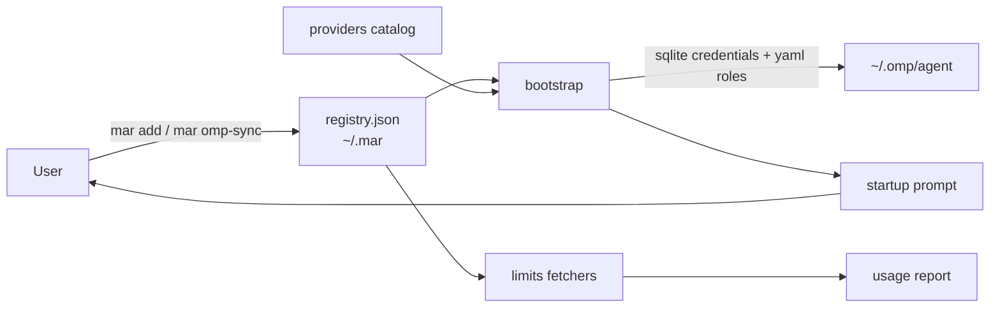

# PLAN.md — MAR (My AI Router)

Source problem: `problem_statement.txt` (verbatim user statement; treat as the
product's constitution).

## Problem

Ten AI subscriptions across ten providers, each with its own keys, models, and
scattered/hidden limits. Every fresh omp (Oh My Pi) install means key hunting,
limit-checking on websites, and per-provider manual setup. The user wants none
of that manual work.

## Product shape

A local CLI (`mar`) + data files. **Not a proxy** — MAR never carries model
traffic. It is a setup assistant and key tracker:

- registry of subscriptions (provider, key, models, default, status)
- one command to see what's active and where each limit lives
- real limit fetches where a provider exposes an API; honest manual-check
  pointers where it doesn't
- one command (`mar omp-sync`) to write everything into an omp install
- one generated startup prompt (`mar prompt`) that bootstraps a fresh omp with
  all providers, default models, and a custom follow-up prompt

## Data flow

## Milestones

| M | Slice | Acceptance criteria (all test-first) | Status |
| --- | --- | --- | --- |
| M0 | Scaffold: repo, docs, conventions, toolchain | `uv sync` works; `pytest` collects; docs complete; pushed to GitHub | done |
| M1 | `registry.py` | CRUD + versioned JSON persistence; atomic save; duplicate/missing errors; empty-file bootstrap; masked display helper | done |
| M2 | `providers.py` | Catalog of the user's providers (9; codebuddy dropped by user — not in omp's roster); integrity validation (unique ids, https URLs, omp id shape); `get()` raises on unknown | done |
| M3 | `omp.py` | Writes `auth_credentials` rows into an agent.db matching omp's live schema (DDL in docs/architecture.md); replaces stale key rows; sets `modelRoles` in config.yml without losing other keys; missing-db bootstrap for fresh installs; `.env` env-var route via `upsert_env_key`; honors `PI_CODING_AGENT_DIR` | done |
| M4 | `limits.py` | Real OpenRouter fetcher (`GET /api/v1/credits`, mocked HTTP in tests); `manual_hint()` returns the catalog's limits URL for the rest; `supported()` truthful | done |
| M5 | `bootstrap.py` | `render_prompt()` emits the startup prompt: all active providers, default models, `mar omp-sync` instructions, custom `~/.mar/prompt.md` section; NEVER contains key material. `sync()` drives omp adapter over the registry and reports written/skipped | done |
| M6 | `cli.py` | Subcommands `add/remove/list/limits/omp-sync/prompt`; exit codes 0/1/2; keys always masked in output; `--json` for `list`; `--key-stdin` keeps keys out of shell history | done |
| M7 | OAuth add-flows per provider | Each provider that supports OAuth gets an interactive add flow; research-gated per provider | planned |
| M8 | Per-provider limit fetchers | Real endpoints researched and implemented one provider at a time (Codex usage, Anthropic admin usage, GitHub Copilot entitlements, …); commandcode billing credits landed in M16, and `omp usage` already reports cline/opencode/zai quota windows | planned |
| M9 | `mar doctor` | Catalog verification report: which omp provider ids are confirmed, which URLs resolve; also reconcile orphaned `.env` vars when a provider's credential route changes | planned |
| M10 | `mar export` | Zero-install pastable (PowerShell/bash) writing omp's agent `.env` from the registry via omp's documented env routes; BEGIN/END framed, commands-only (notes on stderr); `--output` writes 0600; role-sets `config.yml` from the source machine's `modelRoles` idempotently; carries non-credential local `.env` lines; sets hashline edit policy strict (`PI_STRICT_EDIT_MODE=1`, deepseek pinned); pins approval yolo (matches omp default; explicit); pins advisor engagement OFF for task/vibe workers (`task.agentAdvisor` = off — opt in by flipping to on); hides thinking blocks by default (`hideThinkingBlock` = true, display-only); shows generation rate by default (`composer.tokenRate` = true); pins memory defaults (`memory.backend` = mnemopi, `mnemopi.scoping` = per-project, `mnemopi.llmMode` = none, `mnemopi.noEmbeddings` = false); vibe mode itself is per-session `/vibe` (no config key), task/vibe worker routing follows `modelRoles.task` (unset = default); pins a standard `statusLine` (segments identical across installs, no pretty-name `model` segment) and installs `mar-statusline.js`, which prints `provider/api-id` above the band; bash variant fixes `~/.local/bin` PATH (live + `.bashrc`) | done |
| M11 | `mar pull` + OAuth export | Adopt omp credentials into the registry preserving models/defaults: OAuth rows from `agent.db` (anthropic, openai-codex) and env-var credentials from `<agent_dir>/.env` (`omp_env_var`/`export_env_var` → api_key, `export_oauth_env_var` → oauth; env-configured installs have no agent.db rows); export emits `ANTHROPIC_OAUTH_TOKEN` / `OPENAI_CODEX_OAUTH_TOKEN`; expiry warned in output. Access tokens are NOT refreshable via env — re-pull + re-export when they die (anthropic ≈ 8h, codex ≈ 10d) | done |
| M12 | `mar serve` | LAN HTTP server (stdlib `http.server`, no new deps) serving an HTML status page — copy-to-clipboard pastables, configured-services table with live quota (omp usage windows + OpenRouter credits, TTL-cached), renewal/reset times, usage-page links — plus `/config.sh` + `/config.ps1` payloads regenerated per request | done |
| M13 | Vault storage backend + rotation/config | Storage `Store` abstraction (file default, byte-identical); optional KV-v2 vault backend (stdlib urllib — NO new dependency, per the AGENTS.md dependency law); one secret per provider with `updated_at`/`rotated_by`; diffed saves so rotation is one PUT; `mar rotate` preserves subscription metadata; `mar config show/backend [--import]`; `export --redact`; perms hardening (0700 dir on create, 0600 self-tighten, no stranded temp files, serve plaintext warning). Off by default — buddy-grade opt-in | done |
| M14 | Self-hosted endpoint (`strata`) | Catalog entry for the user's LAN llama.cpp server (`http://deepseek.nj02.gurov.us/v1`, moved 2026-11-07 from the retired `http://192.168.1.203:8080/v1`) as a keyless provider: `base_url` + `omp_base_url_env_var` fields with validation (http(s) URL, env route required), `auth_method="none"` in the registry (key forbidden), `mar add strata --default …` needs no key, `omp-sync`/`export` write only `LLAMA_CPP_BASE_URL=<endpoint>` (never a credential), the startup prompt carries endpoint + `llama.cpp/<model>` reference, `mar limits` probes `{endpoint}/models` (live model, `n_ctx`, modalities), and `mar serve` shows that probe plus an endpoint link. Verified end to end: omp answered a `bash` tool call as `llama.cpp/<model>` | done |
| M15 | Second local endpoint (`qwen`) | Catalog entry for the second LAN llama.cpp server (`http://qwen2.nj02.gurov.us/v1`, renamed 2026-11-07 from `qwen.nj02.gurov.us`, which now serves Strata) as a keyless provider on omp's built-in `lm-studio` route (`LM_STUDIO_BASE_URL`): `mar add qwen --default …` needs no key; `omp-sync`/`export` write `LM_STUDIO_BASE_URL=<endpoint>` alongside the existing `LLAMA_CPP_BASE_URL`; `omp-sync`/`export` also declare the subscription's models in omp's `models.yml` (`auth: none`, endpoint, verified `contextWindow: 1048576`) because the built-in `lm-studio` discovery cannot read llama.cpp's `meta.n_ctx` and falls back to 128k; the startup prompt carries endpoint + `lm-studio/<model>` reference; `mar limits` probes that endpoint's own `/models` through one generic self-hosted fetcher, and `mar serve` shows it. Verified end to end: omp completed a plain reply as `lm-studio/qwen3.8-flash-next-abliterated-iq3_s` (2026-11-02) and reports `contextWindow: 1048576` with the declared model (2026-11-08) | done |
| M16 | Alternate accounts per provider | Registry schema v2 adds `accounts` (label + key) and `selected_account`; v1 files load unchanged, save upgrades to v2. `mar account add|select|remove` manages labels (`original` reserved for the primary key) without destroying it. Every credential consumer (`mar export`, `mar omp-sync`, `mar limits`, `mar serve` quota fetches) serves the selected key. `mar serve` renders one row/key with a radio set per provider and `POST /select` persists the choice; each row carries that key's own cached usage (commandcode `GET /alpha/billing/credits`: balance + 5h/7d windows, reset epochs), never the local omp snapshot moved between rows; usage renders as inline percent-filled progress bars with exact values on hover (commandcode Monthly is derived from the rolling caps), in the web page and `mar limits`. Apply commands include `?accounts=provider=label` so the copied curl/irm line names the delivered key; `mar export --account` pins the same way without persisting. `mar pull` preserves accounts/selection. Tests cover validation, legacy load, export/sync switching, per-key usage, and the HTTP endpoints | done |
| M17 | tokenpool routing integration | Serve page Routing card links to the tokenpool control panel; `mar export --tokenpool` / `$MAR_TOKENPOOL_URL` reads `/v1/models` and declares the keyless `tokenpool` omp provider (models, context/output caps) in `models.yml`; `/config.*` inherit the env; MAR still carries no model traffic | done |

## Slice ownership (for parallel agent work)

- Wave A (independent): M1 registry, M2 providers, M3 omp — file-disjoint.
- Wave B (needs A): M4 limits (uses registry + providers), M5 bootstrap (uses
  registry + providers + omp).
- Wave C: M6 cli (uses everything), full-suite verification, integration
  commits.

## Conventions

- See AGENTS.md for the TDD loop and hard rules.
- Registry file: `~/.mar/registry.json`, versioned (`"version": 2`; v1 loads
  and upgrades on next save), atomic writes, 0600 best-effort (Windows:
  document, don't fake ACLs).
- Keys are stored locally in plaintext in the registry — explicit, documented tradeoff;
  keyring integration is a future milestone, not silent scope.
- Every omp-facing fact is recorded in docs/architecture.md with how it was
  verified (live agent.db inspection, 2026-10-10).

## Out of scope (per user)

- Any traffic proxying, request routing, or key rotation in-flight.
- Web UI. CLI only.
- Storing keys in cloud sync.
