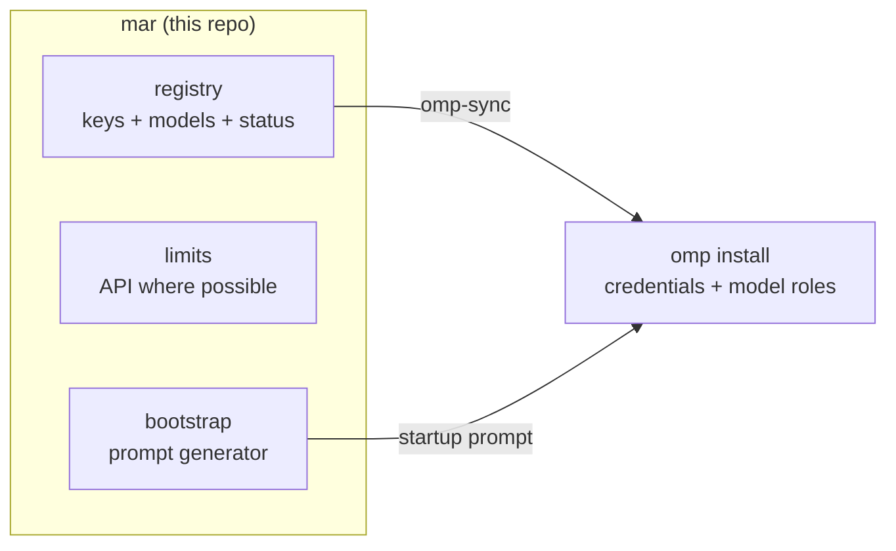

# MAR — My AI Router

Local setup assistant and key tracker for people with too many AI
subscriptions. MAR is **not a proxy**: no model traffic flows through it. It
remembers your providers, keys, default models, and where each provider's
usage/limits live, then configures an [Oh My Pi](https://github.com/canopy/omp)
(omp) install in one shot.



## Commands

| Command | What it does |
| --- | --- |
| `mar add <provider> --key KEY` | Register a subscription (models/defaults optional flags) |
| `mar list [--json]` | Active subscriptions, masked keys, default models |
| `mar limits [provider]` | Usage where an API exists (OpenRouter); else prints exactly where to look |
| `mar omp-sync [--set-role role=model]` | Writes every stored key into omp's credential store; optionally sets `modelRoles` |
| `mar prompt` | Prints THE startup prompt to paste into a fresh omp install |
| `mar remove <provider>` | Forget a subscription |

## Quickstart

```bash
uv tool install -e .   # from the repo: installs `mar` on PATH (any shell)
mar --help
uv sync                # dev setup: venv + pytest + ruff
uv run pytest          # TDD harness
```

`uv tool install -e .` is editable: code changes in the repo apply to the
global `mar` immediately. Without it, run everything as `uv run mar …` from
the repo directory.

Data lives in `~/.mar/registry.json` (override with `MAR_HOME`). omp integration
targets `~/.omp/agent` (override with `PI_CODING_AGENT_DIR` — the same variable
omp itself honors, so you can point MAR at an isolated omp install).

## Status

M0 scaffold. Milestones and acceptance criteria: [PLAN.md](PLAN.md).
Contracts (incl. omp's `agent.db` schema): [docs/architecture.md](docs/architecture.md).

## Repo working rules

Humans and agents: read [AGENTS.md](AGENTS.md) before your first edit. TDD is
mandatory, commits land green only, keys never get printed or committed.
