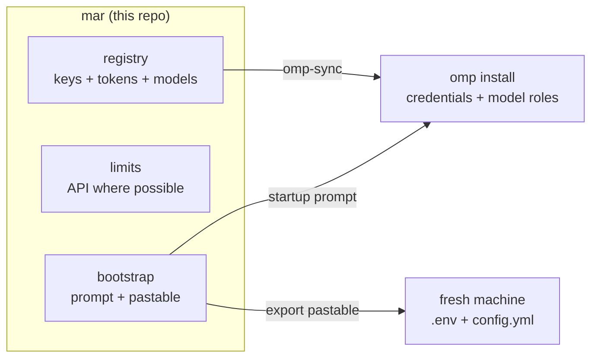

# MAR — My AI Router

Local setup assistant and key tracker for people with too many AI
subscriptions. MAR is **not a proxy**: no model traffic flows through it. It
remembers your providers, keys, OAuth tokens, and default model roles, then
configures an [Oh My Pi](https://github.com/canopy/omp) (omp) install in one
shot — or emits a **zero-install pastable** that configures any machine that
has omp but no MAR.



## The problem it solves

Ten AI subscriptions across ten providers, each with its own keys, models,
and hidden/scattered limits. Every fresh omp install used to mean key hunting,
limit-checking on vendor websites, and per-provider manual setup. MAR turns
that into one command (or one paste).

## Commands

| Command | What it does |
| --- | --- |
| `mar add <provider> --key KEY` | Register a subscription (`--key-stdin` avoids shell history; `--default` picks a model) |
| `mar list [--json]` | Active subscriptions, masked keys, default models |
| `mar limits [provider]` | Usage where an API exists (OpenRouter credits); else prints exactly where to look |
| `mar omp-sync [--set-role role=model]` | Writes every stored key into omp's credential store / `.env`; sets `modelRoles` |
| `mar pull` | Adopts OAuth logins (Claude, Codex) from the local omp install into the registry |
| `mar export [--shell bash] [--output F]` | Emits the zero-install pastable: commands-only, framed by BEGIN/END markers |
| `mar prompt` | Prints THE startup prompt to paste into a fresh omp session |
| `mar remove <provider>` | Forget a subscription |

Exit codes: 0 ok, 1 runtime error, 2 usage. Keys are always masked in output.

## The zero-install pastable

On the MAR machine:

```powershell
mar export
```

stdout is a copy-paste block (framed by `# === BEGIN ===` / `# === END ===`,
commands only — notes go to stderr). On the target machine, paste it into
PowerShell or bash. It:

1. writes omp's agent `.env` with every credential via omp's documented env
   routes (`ZAI_API_KEY`, `CLINE_API_KEY`, `OPENCODE_API_KEY`,
   `OPENROUTER_API_KEY`, `CURSOR_ACCESS_TOKEN`, `ANTHROPIC_OAUTH_TOKEN`,
   `OPENAI_CODEX_OAUTH_TOKEN`, `TYPESAFE_API_KEY`);
2. role-sets `config.yml` from the source machine's `modelRoles` (judge,
   default) — create if missing, append if absent, skip if already present
   (idempotent, never clobbers).

Then `omp usage` to verify, `omp --yolo` to work. Providers without an env
route are skipped with an explicit `/login <provider>` hint on stderr.
OAuth tokens expire (Anthropic ≈ 8h, Codex ≈ 10d) — when they do, re-run
`mar pull && mar export` on the MAR machine and re-paste.

## Verified (2026-10-10, live)

- omp contracts read from a live install: `agent.db:auth_credentials` DDL +
  row shapes (api_key and oauth), `config.yml:modelRoles`, `PI_CODING_AGENT_DIR`
  override, `.env` loading, provider roster with env-var map.
- Isolated agent dir: `mar omp-sync` from empty → `omp usage` returned live
  quota windows (Cline/OpenCode/Z.ai); one-shot inference via zai, anthropic
  (OAuth env), openai-codex (OAuth env), and OpenRouter all succeeded.
- Pastable-only proof: bare simulated machine (no MAR, no agent.db) →
  pasted block → live usage + inference; double-run is idempotent.
- OpenRouter credits live: `mar limits openrouter` → real dollars/credits.

## Providers (10)

cursor-grok (Cursor/Grok), codex (OpenAI Codex), claude (Anthropic),
cline, opencode, zai, openrouter, antigravity, copilot, jev (Typesafe judge —
role-only, backs `modelRoles.judge`). Catalog: `src/mar/providers.py`,
editorial data + verification status: [docs/providers.md](docs/providers.md).
Every omp id/env var confirmed against omp's official roster; codebuddy was
dropped (not in omp's roster).

## Quickstart

```bash
uv tool install -e .   # from the repo: installs `mar` on PATH (any shell)
mar --help
uv sync                # dev setup: venv + pytest + ruff
uv run pytest          # TDD harness (243 tests)
```

Editable install: code changes apply to the global `mar` immediately. Without
it, run everything as `uv run mar …` from the repo directory.

Data lives in `~/.mar/registry.json` (override `MAR_HOME`); omp integration
targets `~/.omp/agent` (override `PI_CODING_AGENT_DIR` — the same variable omp
honors, so you can point MAR at an isolated omp install).

## Build log — 2026-10-10 (one session)

1. **Scaffold** — repo, PLAN.md milestones, AGENTS.md TDD conventions,
   architecture contracts derived from a live omp inspection.
2. **Wave A (parallel agent pool)** — `registry` (subscription store),
   `providers` (catalog + validation), `omp` (agent.db + config.yml adapter):
   106 tests, each slice red-first.
3. **Wave B (pool)** — `limits` (OpenRouter fetcher + manual hints),
   `bootstrap` (startup prompt + one-shot sync): 52 more tests.
4. **CLI** — full command surface, masked keys, typed exit codes.
5. **Catalog ground-truthing** — omp roster cross-check; codebuddy dropped,
   openrouter/cursor/claude/codex/antigravity/copilot ids + env routes
   verified, `verified` semantics fixed to "omp-id confirmed".
6. **Real configuration** — 5 API keys + 2 OAuth logins registered and
   synced into the live omp install (backups kept); `.env` env-var route
   added for OAuth-first providers (cursor).
7. **`mar export`** — zero-install pastable (BEGIN/END framed,
   commands-only, notes on stderr, `--output` 0600).
8. **`mar pull` + OAuth export** — Claude/Codex tokens adopted from omp and
   carried in the pastable, expiry-warned.
9. **Role-setting pastable** — `modelRoles` (judge/default) cloned into
   fresh machines, idempotently.
10. **Global install** — `uv tool install -e .` so `mar` works in any
    shell/directory.

## Repo working rules

Humans and agents: read [AGENTS.md](AGENTS.md) before your first edit. TDD is
mandatory (failing test first, green-only commits), keys never get printed or
committed, tests never touch real user state. Milestones and status:
[PLAN.md](PLAN.md). Contracts: [docs/architecture.md](docs/architecture.md).

## Status

Done: M0–M6, M10, M11 (+ role-set export). Planned: M7 per-provider OAuth
add-flows, M8 deeper limit fetchers (until then `omp usage` covers
cline/opencode/zai), M9 `mar doctor` (catalog/URL verification, orphaned
`.env` reconciliation).
